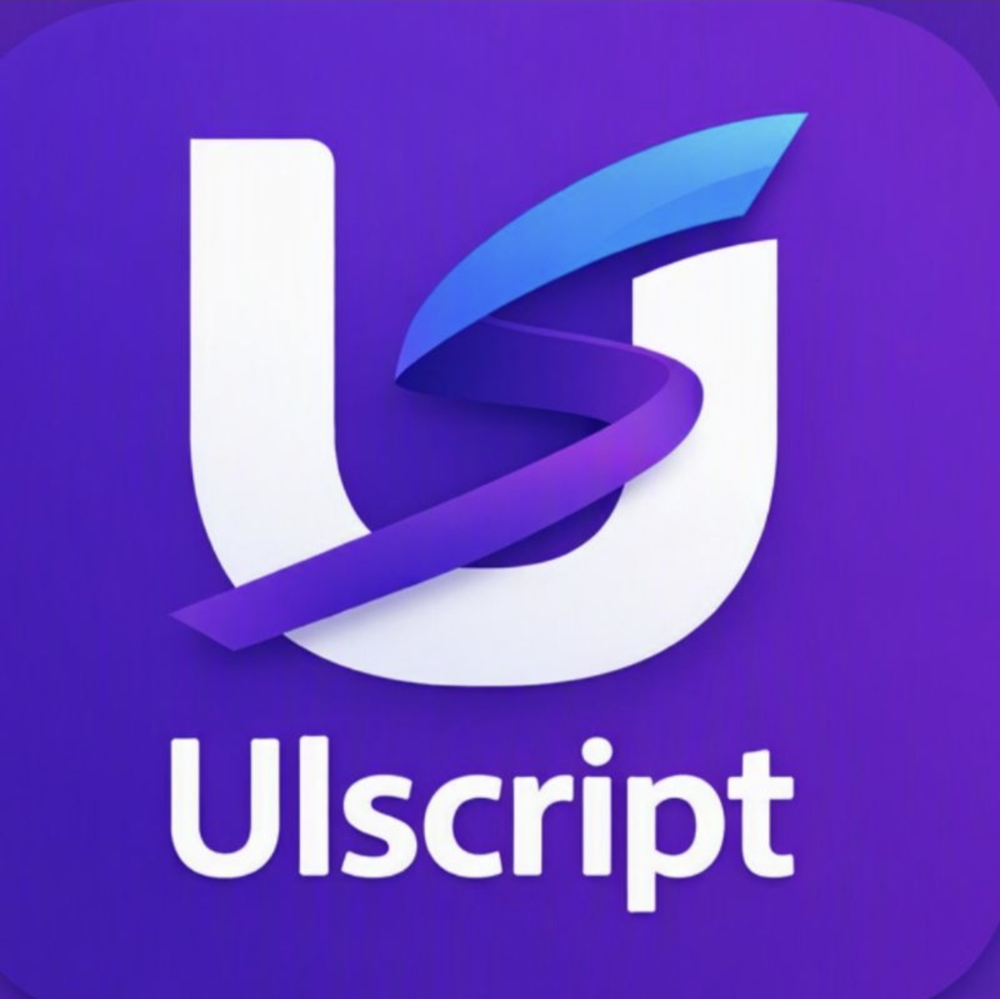
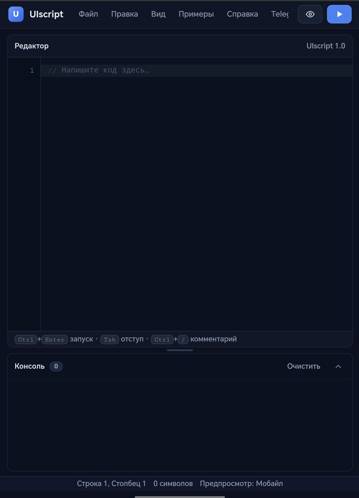

<a id="top"></a>

# UIscript — среда разработки и самоучитель / UIscript — IDE and Self-Study Guide

<p align="center">
  <b>Язык интерактивных интерфейсов для начинающих: от первой строки до мини-приложений в браузере.</b><br>
  <i>A beginner-friendly language for interactive interfaces: from the first line of code to mini web apps in the browser.</i>
</p>


**Версия / Version:** 1.0 · **Редакция самоучителя / Guide edition:** октябрь 2026 / October 2026

**Языки / Languages:** [Русский](#russian) · [English](#english)

---

<a id="russian"></a>

# 🇷🇺 Русский

## Содержание

- [Что это такое](#ru-what-is-it)
- [Состав репозитория](#ru-repo)
- [Быстрый старт](#ru-quick-start)
- [Возможности среды](#ru-features)
- [Краткий обзор языка](#ru-language)
- [Ограничения](#ru-limitations)
- [Учебный маршрут](#ru-learning-path)
- [Структура исходного кода](#ru-source)
- [Совместимость и версии](#ru-compatibility)
- [Безопасность](#ru-security)
- [Как помочь проекту](#ru-contributing)
- [Лицензия](#ru-license)
- [Ссылки](#ru-links)

<a id="ru-what-is-it"></a>

## Что это такое

**UIscript** — небольшой предметно-ориентированный язык (DSL) для создания интерактивных окон и мини-приложений в браузере. Вы описываете элементы интерфейса и их поведение короткими строками, а среда сама строит страницу. Для базовых задач не нужно знать HTML, CSS или JavaScript.

Язык намеренно простой и русскоязычный, но это **отдельный язык со своим синтаксисом**, а не подмножество JavaScript. Поддерживаются английские псевдонимы команд (`window`, `button`, `click:` и т. д.).

Весь проект — **один HTML-файл** без внешних зависимостей и без этапа сборки: откройте его в браузере, и среда готова к работе.

<a id="ru-repo"></a>

## Состав репозитория

| Файл | Назначение |
|------|------------|
| Среда разработки (единственный HTML-файл проекта) | Редактор, консоль, предпросмотр, парсер, исполнитель и экспорт. Открывается в браузере без установки. |
| `README.md` | Этот файл. |
| `LICENSE` | Текст лицензии Apache License 2.0. |

Самоучители (PDF на русском и английском языке: 19 глав, 4 законченных проекта, упражнения с решениями) хранятся отдельно от кода, в других репозиториях, и предназначены только для обучения. Ссылки на них — в разделе [Ссылки](#ru-links).

<a id="ru-quick-start"></a>

## Быстрый старт

1. Скачайте репозиторий или только HTML-файл среды.
2. Откройте HTML-файл в современном браузере (двойной щелчок или меню браузера «Открыть файл»).
3. Вставьте код в редактор и нажмите **«Запустить»** или `Ctrl+Enter` (на macOS — `Cmd+Enter`).

В редакторе уже есть стартовый пример, поэтому первый запуск можно выполнить сразу. Попробуйте и свою первую программу:

```text
окно "Привет"
  заголовок "Привет, мир!"
  текст "Это моя первая программа на UIscript."
  кнопка "Поздороваться"
    нажми:
      сообщение "Привет! Кнопка сработала."
      показать "Это запись в консоли."
```

Отступы задают структуру: строки с отступом вложены в элемент, который стоит выше. Используйте два пробела на уровень.

<a id="ru-features"></a>

## Возможности среды

**Редактор и работа с кодом**
- Нумерация строк, подсветка синтаксиса, строка состояния (позиция курсора и количество символов).
- Автоматические отступы при Enter, `Tab` / `Shift+Tab`, комментирование `Ctrl+/`.
- Отмена действий `Ctrl+Z`, сохранение `Ctrl+S`.
- Режим **автозапуска при вводе** (меню «Вид»).
- Изменение размера шрифта.

**Выполнение и предпросмотр**
- Окно предпросмотра с переключением между видом для рабочего стола и мобильного экрана.
- Консоль: `показать` пишет только в консоль, `сообщение` дополнительно выводит всплывающее уведомление.
- Понятные сообщения об ошибках с переходом к строке, где они возникли.

**Примеры и шаблоны**
- **19 встроенных примеров**: кнопка и сообщение, реактивный счётчик, форма и условия, список покупок, ползунок, таблица умножения, стили и переключение, калькулятор, секундомер, часы, «Угадай число», блокировка кнопки и ссылка, свои функции, живой пересчёт (температура), счётчик символов, отложенное действие, медиа, запрос к API (погода), условные свойства.
- **7 шаблонов** для быстрого старта: открытка с поздравлением, визитка, викторина, прайс-лист, обратный отсчёт, форма заявки, калькулятор чаевых.

**Файлы и обмен**
- «Файл» → «Импорт файла…» (`.uis`, `.txt`).
- «Файл» → «Сохранить код (.uis)».
- «Файл» → «Показать HTML» и «Скачать приложение (.html)» — автономная страница, которая запускается без среды.
- «Файл» → «Скопировать ссылку на код» — ссылка, по которой открывается та же программа.

**Хранение данных**
- Код автоматически сохраняется в `localStorage` браузера под ключом `uis_code_v1` (настройки — `uis_prefs_v1`). Данные остаются только в вашем браузере. Для важных проектов сохраняйте отдельный файл `.uis`.

<a id="ru-language"></a>

## Краткий обзор языка

| Группа | Что входит |
|--------|------------|
| **Элементы** | `окно`, `заголовок`, `подзаголовок`, `текст`, `кнопка`, `ссылка`, `поле`, `область`, `галочка`, `ползунок`, `выбор` / `вариант`, `список`, `картинка`, `видео`, `строка`, `столбец`, `карточка`, `разделитель` |
| **Свойства** | `фон`, `цвет`, `размер`, `жирный`, `курсив`, `центр`, `подсказка`, `ширина`, `высота`, `отступ`, `скругление`, `рамка`, `тень`, `прозрачность`, `невидимый`, `выключен`, `мин`, `макс`, `значение`, `адрес` |
| **События** | `нажми:`, `измени:`, `наведи:`, `уход:` |
| **Действия** | `сообщение`, `показать`, `установить`, `очистить`, `добавить`, `удалить`, `скрыть`, `открыть`, `переключить`, `включить`, `отключить`, `фокус`, `запрос`, `вызвать` |
| **Управление** | `пусть`, `если` / `иначе если` / `иначе`, `повторить N раз:`, `функция имя(...):`, `вернуть`, `каждую секунду:`, `каждые 5 сек:`, `через 3 сек:` |
| **Функции** | `число`, `число_ли`, `округлить`, `пол`, `потолок`, `абс`, `мин`, `макс`, `случайное`, `длина`, `верхний`, `нижний`, `обрезать`, `пусто`, `путь`, `сейчас`, `дата`, `секунд_до` |

Пример реактивного интерфейса: надпись обновляется сама, когда меняется переменная.

```text
пусть счётчик = 0
окно "Счётчик"
  заголовок "{счётчик}"
  кнопка "+1"
    нажми:
      счётчик += 1
```

Пример проверки ввода:

```text
окно "Сумма"
  поле а "Первое число"
  поле б "Второе число"
  кнопка "Сложить"
    нажми:
      если не число_ли(а) или не число_ли(б)
        сообщение "Введите два числа."
      иначе
        пусть сумма = число(а) + число(б)
        сообщение "Сумма: {сумма}"
```

Полный справочник — в самоучителе (глава 18).

<a id="ru-limitations"></a>

## Ограничения

Ограничения версии 1.0:

- Нет циклов `while`, а также команд `break` и `continue`. Для досрочного выхода вынесите цикл в функцию и используйте `вернуть`.
- В одном `повторить` — не более **10 000** повторений.
- За один запуск выполняется не более **1 000 000** внутренних шагов (защита от зависания).
- Вложенных вызовов функций — не более **100**.
- Сетевые запросы (`запрос`): только `http://` и `https://`, тайм-аут **15 с**, не более **10** одновременных запросов. Действуют правила CORS: если сервер не разрешает запрос со страницы среды, обойти это средствами среды нельзя.
- Условная форма свойств (`… если условие`) поддерживается только для: `выключен`, `невидимый`, `жирный`, `курсив`, `центр`. Условного `цвет если` нет.
- Таймеры (подробнее в самоучителе, глава 17): минимальный интервал повторяющегося таймера **50 мс**, не более **50** активных таймеров.
- Изображения и видео загружаются по URL; если ресурс недоступен, показывается заглушка.
- Экспортированный HTML не делает внешние ресурсы локальными: картинки и API по-прежнему требуют сети.

<a id="ru-learning-path"></a>

## Учебный маршрут

| Этап | Что освоить | Проверка |
|------|-------------|----------|
| 1. Основы | Строки, отступы, окно, текст, кнопка | Приветствие с кнопкой |
| 2. Данные | Имена элементов, переменные, выражения | Сложение двух чисел |
| 3. Поведение | Условия, события, действия | Проверка формы с ошибкой |
| 4. Повторение | Циклы и функции | Таблица умножения |
| 5. Динамика | Таймеры и реактивность | Счётчик или часы |
| 6. Приложения | Списки, выбор, запросы, экспорт | Законченное мини-приложение |

Самоучитель содержит 4 законченных проекта: **калькулятор четырёх операций**, **список покупок**, **мини-викторину** и **обратный отсчёт**.

Совет: после каждого раздела меняйте хотя бы одну строку и проверяйте, понимаете ли вы причину изменения результата.

<a id="ru-source"></a>

## Структура исходного кода

Среда реализована в одном файле без внешних библиотек:

- **Стили** — блок `<style>` (строки 9–1063).
- **Разметка интерфейса** — меню, редактор, консоль, предпросмотр, модальные окна (строки 1064–1485).
- **Логика** — блок `<script>` (строки 1486–6548).

Основные части логики:

- **Парсер** — `parseProgram`, `parseStatement`, `parseElement`, `parseEvent`, `parseIf`, `parseRepeat`, `parseFunction`, `parseTimer`, `parseRequestClause`. Английские псевдонимы переводятся через таблицу `EN_ALIASES`.
- **Выражения** — `compileExpression`, `evalExpression`, `looseEquals`, `compareValues`.
- **Исполнитель** — `createRuntime`, `executeStatements`, `executeNode`, `executeAction`, `executeIf`, `executeRepeat`, `executeTimer`, `executeRequest`, `callUserFunction`.
- **Рендер и реактивность** — `renderElement`, `interpolate`, `refreshReactive`, `scheduleReactiveRefresh`, `applyConditionalProps`.
- **Экспорт и ссылки** — `buildStandaloneHtml`, `prepareHtmlExport`, `dryRunSource`, `encodeShare`, `decodeShare`.
- **Интерфейс** — `runCode`, `saveSource`, `openPreview`, `renderExamples`, `scheduleAutoRun`.

Перед экспортом среда разбирает исходный код, выполняет «сухой прогон» без таймеров и сетевых запросов, а затем проверяет, что встроенный JavaScript собирается.

<a id="ru-compatibility"></a>

## Совместимость и версии

- Описание языка соответствует **версии 1.0** среды.
- При изменении команд или ограничений сверяйтесь с самой средой: она является источником истины.
- Для запуска нужен современный браузер с поддержкой JavaScript (ES6+) и `localStorage`.

<a id="ru-security"></a>

## Безопасность

- **Не храните** пароли, секретные ключи API и приватные данные в программе или экспортированном HTML: это исполняемый код, его можно открыть и прочитать.
- Экспортированный HTML отправляйте только тогда, когда готовы раскрыть содержимое приложения.
- Автосохранение хранит код только в браузере; при очистке данных сайта код может пропасть, поэтому сохраняйте `.uis`-файлы.
- Внешние запросы выполняются из браузера и подчиняются его политикам безопасности. Используйте только API, которым доверяете.

<a id="ru-contributing"></a>

## Как помочь проекту

- **Сообщить об ошибке** — создайте issue в [репозитории на GitHub](https://github.com/gromhorse90022110-dot/uis_uiscript) и приложите минимальный пример кода, ожидаемое и фактическое поведение, браузер и устройство.
- **Предложить улучшение** — откройте issue с описанием задачи и примером использования.
- **Предложить изменение кода** — создайте fork и pull request. Перед отправкой проверьте:
  - все 19 встроенных примеров запускаются без ошибок;
  - все 7 шаблонов открываются и работают;
  - экспорт `.html` открывается отдельно и работает;
  - самоучитель и README соответствуют новому поведению.
- **Обсудить** — пишите в [Telegram-канал](https://t.me/uis_uiscript).

<a id="ru-license"></a>

## Лицензия

Проект распространяется под лицензией [Apache License 2.0](LICENSE). Полный текст лицензии находится в файле `LICENSE`.

<a id="ru-links"></a>

## Ссылки

- Исходный код и issues: https://github.com/gromhorse90022110-dot/uis_uiscript
- Telegram-канал: https://t.me/uis_uiscript
- Самоучитель (PDF, русский, отдельный проект): https://gromhorse90022110-dot.github.io/uis_pdf_ru/
- Самоучитель (PDF, English, отдельный проект): https://gromhorse90022110-dot.github.io/uis_pdf_en/

[↑ наверх](#top)

---

<a id="english"></a>

# 🇬🇧 English

## Contents

- [What is it](#en-what-is-it)
- [Repository contents](#en-repo)
- [Quick start](#en-quick-start)
- [IDE features](#en-features)
- [Language overview](#en-language)
- [Limitations](#en-limitations)
- [Learning path](#en-learning-path)
- [Source code structure](#en-source)
- [Compatibility and versions](#en-compatibility)
- [Security](#en-security)
- [Contributing](#en-contributing)
- [License](#en-license)
- [Links](#en-links)

<a id="en-what-is-it"></a>

## What is it

**UIscript** is a small domain-specific language (DSL) for building interactive windows and mini web apps in the browser. You describe interface elements and their behavior with short lines of code, and the IDE builds the page for you. Basic tasks do not require HTML, CSS, or JavaScript.

The language uses Russian keywords by default, and **English aliases are supported** (`window`, `button`, `click:`, `if`, `function`, and so on). UIscript is **its own language with its own syntax**, not a subset of JavaScript.

The whole project is **a single HTML file** with no external dependencies and no build step. Open it in a browser and start coding.

<a id="en-repo"></a>

## Repository contents

| File | Purpose |
|------|---------|
| The IDE (the single HTML file in the project) | Editor, console, preview, parser, runtime, and export. Opens in a browser with no installation. |
| `README.md` | This file. |
| `LICENSE` | Text of the Apache License 2.0. |

The guides (PDF in Russian and English: 19 chapters, 4 complete projects, exercises with solutions) are stored separately from the code, in other repositories, and are intended for learning only. See [Links](#en-links).

<a id="en-quick-start"></a>

## Quick start

1. Download or clone the repository (or just the IDE HTML file).
2. Open the HTML file in a modern browser.
3. Paste code into the editor and press **Run** or `Ctrl+Enter` (`Cmd+Enter` on macOS).

The editor already contains a starter example, so you can run it right away. Or try your first program:

```text
окно "Привет"
  заголовок "Привет, мир!"
  текст "Это моя первая программа на UIscript."
  кнопка "Поздороваться"
    нажми:
      сообщение "Привет! Кнопка сработала."
      показать "Это запись в консоли."
```

Indentation defines structure: indented lines belong to the element above them. Use two spaces per level.

<a id="en-features"></a>

## IDE features

**Editor**
- Line numbers, syntax highlighting, status bar (cursor position and character count).
- Automatic indentation on Enter, `Tab` / `Shift+Tab`, line comments with `Ctrl+/`.
- Undo with `Ctrl+Z`, save with `Ctrl+S`.
- **Auto-run on input** (View menu).
- Adjustable font size.

**Running and preview**
- Preview window with a switch between desktop and mobile layouts.
- Console: `показать` (show) writes to the console only; `сообщение` (message) also shows a toast notification.
- Error messages with navigation to the offending line.

**Examples and templates**
- **19 built-in examples**: button and message, reactive counter, form and conditions, shopping list, slider, multiplication table, styles and toggles, calculator, stopwatch, clock, "Guess the number", disabled button and link, custom functions, live recalculation (temperature), character counter, delayed action, media, API request (weather), conditional properties.
- **7 templates** to start from: greeting card, business card, quiz, price list, countdown, request form, tip calculator.

**Files and sharing**
- File → Import (`.uis`, `.txt`).
- File → Save code (`.uis`).
- File → Show HTML, and File → Download app (`.html`) — a standalone page that runs without the IDE.
- File → Copy link to code — a link that opens the same program.

**Storage**
- Code is saved automatically to the browser's `localStorage` under the key `uis_code_v1` (preferences: `uis_prefs_v1`). Data stays in your browser. Save important projects as `.uis` files.

<a id="en-language"></a>

## Language overview

| Group | Contents |
|-------|----------|
| **Elements** | `окно` (window), `заголовок` (heading), `подзаголовок` (subheading), `текст` (text), `кнопка` (button), `ссылка` (link), `поле` (input), `область` (textarea), `галочка` (checkbox), `ползунок` (slider), `выбор` / `вариант` (select / option), `список` (list), `картинка` (image), `видео` (video), `строка` (row), `столбец` (column), `карточка` (card), `разделитель` (divider) |
| **Properties** | `фон`, `цвет`, `размер`, `жирный`, `курсив`, `центр`, `подсказка`, `ширина`, `высота`, `отступ`, `скругление`, `рамка`, `тень`, `прозрачность`, `невидимый`, `выключен`, `мин`, `макс`, `значение`, `адрес` |
| **Events** | `нажми:` (click), `измени:` (change), `наведи:` (hover), `уход:` (leave) |
| **Actions** | `сообщение`, `показать`, `установить`, `очистить`, `добавить`, `удалить`, `скрыть`, `открыть`, `переключить`, `включить`, `отключить`, `фокус`, `запрос`, `вызвать` |
| **Control flow** | `пусть` (let), `если` / `иначе если` / `иначе` (if / else if / else), `повторить N раз:` (repeat), `функция` (function), `вернуть` (return), `каждую секунду:` (every second), `каждые 5 сек:`, `через 3 сек:` (after 3 seconds) |
| **Built-in functions** | `число`, `число_ли`, `округлить`, `пол`, `потолок`, `абс`, `мин`, `макс`, `случайное`, `длина`, `верхний`, `нижний`, `обрезать`, `пусто`, `путь`, `сейчас`, `дата`, `секунд_до` |

A reactive interface example: the label updates automatically when the variable changes.

```text
пусть счётчик = 0
окно "Счётчик"
  заголовок "{счётчик}"
  кнопка "+1"
    нажми:
      счётчик += 1
```

Input validation example:

```text
окно "Сумма"
  поле а "Первое число"
  поле б "Второе число"
  кнопка "Сложить"
    нажми:
      если не число_ли(а) или не число_ли(б)
        сообщение "Введите два числа."
      иначе
        пусть сумма = число(а) + число(б)
        сообщение "Сумма: {сумма}"
```

The full reference is in the guide (chapter 18, in Russian).

<a id="en-limitations"></a>

## Limitations

Limitations of version 1.0:

- No `while` loops and no `break` / `continue`. To exit early, move the loop into a function and use `вернуть` (return).
- A `повторить` loop runs at most **10,000** iterations.
- At most **1,000,000** internal execution steps per run (protection against hangs).
- Function calls can nest at most **100** levels deep.
- Network requests (`запрос`) accept only `http://` and `https://`, have a timeout of **15 seconds**, and allow at most **10** concurrent requests. CORS applies: if the server does not allow requests from the IDE's page, the IDE cannot bypass it.
- Conditional property form (`… если condition`) is supported only for: `выключен`, `невидимый`, `жирный`, `курсив`, `центр`. There is no `цвет если`.
- Timers (see chapter 17 of the guide): the minimum interval for a repeating timer is **50 ms**, and at most **50** timers can be active at once.
- Images and videos load from URLs; if a resource is unavailable, a placeholder is shown.
- An exported HTML file does not make external resources local: images and APIs still require network access.

<a id="en-learning-path"></a>

## Learning path

| Stage | What to learn | Checkpoint |
|-------|---------------|------------|
| 1. Basics | Strings, indentation, window, text, button | Greeting with a button |
| 2. Data | Element names, variables, expressions | Add two numbers |
| 3. Behavior | Conditions, events, actions | Form validation with an error message |
| 4. Repetition | Loops and functions | Multiplication table |
| 5. Dynamics | Timers and reactivity | Counter or clock |
| 6. Apps | Lists, selects, requests, export | A complete mini app |

The guide includes 4 complete projects: a **four-operation calculator**, a **shopping list**, a **mini quiz**, and a **countdown timer**.

Tip: after each section, change at least one line and check whether you understand why the result changed.

<a id="en-source"></a>

## Source code structure

The IDE is implemented as one file with no external libraries:

- **Styles** — the `<style>` block (lines 9–1063).
- **Interface markup** — menus, editor, console, preview, modal dialogs (lines 1064–1485).
- **Logic** — the `<script>` block (lines 1486–6548).

Main logic components:

- **Parser** — `parseProgram`, `parseStatement`, `parseElement`, `parseEvent`, `parseIf`, `parseRepeat`, `parseFunction`, `parseTimer`, `parseRequestClause`. English aliases are mapped through the `EN_ALIASES` table.
- **Expressions** — `compileExpression`, `evalExpression`, `looseEquals`, `compareValues`.
- **Runtime** — `createRuntime`, `executeStatements`, `executeNode`, `executeAction`, `executeIf`, `executeRepeat`, `executeTimer`, `executeRequest`, `callUserFunction`.
- **Rendering and reactivity** — `renderElement`, `interpolate`, `refreshReactive`, `scheduleReactiveRefresh`, `applyConditionalProps`.
- **Export and sharing** — `buildStandaloneHtml`, `prepareHtmlExport`, `dryRunSource`, `encodeShare`, `decodeShare`.
- **UI** — `runCode`, `saveSource`, `openPreview`, `renderExamples`, `scheduleAutoRun`.

Before exporting, the IDE parses the source, performs a dry run without timers or network requests, and checks that the embedded JavaScript compiles.

<a id="en-compatibility"></a>

## Compatibility and versions

- The language description matches **version 1.0** of the IDE.
- If commands or limits change, check them against the IDE itself, which is the source of truth.
- A modern browser with JavaScript (ES6+) and `localStorage` support is required.

<a id="en-security"></a>

## Security

- **Do not store** passwords, API secret keys, or private data in a program or in an exported HTML file. These are executable and can be read by anyone.
- Share exported HTML only when you are ready to reveal the app's contents.
- Auto-save keeps code only in the user's browser; clearing site data can erase it, so keep `.uis` backups.
- Network requests run from the browser and follow its security policies. Only use APIs you trust.

<a id="en-contributing"></a>

## Contributing

- **Report a bug** — open an issue in the [GitHub repository](https://github.com/gromhorse90022110-dot/uis_uiscript) with a minimal code sample, the expected and actual behavior, your browser, and your device.
- **Suggest an improvement** — open an issue describing the task and a usage example.
- **Submit a code change** — fork the repository and open a pull request. Before submitting, check that:
  - all 19 built-in examples run without errors;
  - all 7 templates open and work;
  - the `.html` export opens and works on its own;
  - the guide and this README match the new behavior.
- **Discuss** — join the [Telegram channel](https://t.me/uis_uiscript).

<a id="en-license"></a>

## License

This project is licensed under the [Apache License 2.0](LICENSE). The full license text is in the `LICENSE` file.

<a id="en-links"></a>

## Links

- Source code and issues: https://github.com/gromhorse90022110-dot/uis_uiscript
- Telegram channel: https://t.me/uis_uiscript
- Self-study guide (PDF, Russian, separate project): https://gromhorse90022110-dot.github.io/uis_pdf_ru/
- Self-study guide (PDF, English, separate project): https://gromhorse90022110-dot.github.io/uis_pdf_en/

[↑ back to top](#top)
